# 3 Laboratorinis darbas

## PS produkto kokybės matavimas ir vertinimas

Tyrėme **SIT** mobiliąją programėlę pagal ISO/IEC 25010:2023: **8 subcharakteristikas, 16 metrikų ir 32 matavimo atvejus**. Iš jų 26 atitiko komandos ribas, 6 – neatitiko.

**Aplinka:** 2026-11-02, Android 16 (API 36, 1080 × 2400, 420 dpi) emuliatorius ir papildomai iOS 26.4 simuliatorius. Naudota development versija; rezultatai taikomi šiai aplinkai.

**Įrankiai:** [Maestro](https://docs.maestro.dev/) veiksmams ir UI medžiui, [ADB / dumpsys](https://developer.android.com/tools/dumpsys#meminfo) RAM ir ekrano vaizdams, performance.now() trukmėms, [Appwrite REST API](https://appwrite.io/docs/references/cloud/client-rest) saugumui.

Laiko scenarijus kartojome po **20**, RAM – po **3**, elgsenos ir saugumo – po **10 kartų**. p95 yra 19-a surikiuota reikšmė iš 20. Slenksčius pasirinkome prieš matavimą; tai komandos kriterijai, ne ISO nustatytos ribos. Žalia zona – atitinka, raudona – neatitinka. Procentai rodo teisingai suvaldytų atvejų dalį.

Matavome atskirose 3LD kolekcijose su nukopijuota schema, indeksais, teisėmis ir dviem testinėmis paskyromis. Esamų įrašų nekeitėme. Dėl bucket kvotos tik naujus registruotus testinius failus įkėlėme į esamą saugyklą ir iškart pašalinome.

## 1 Nojus Stankevičius

**Time behavior ir Fault tolerance.** Reikalavimai: [SIT-42](https://placeholdder.atlassian.net/browse/SIT-42) ir [SIT-48](https://placeholdder.atlassian.net/browse/SIT-48).

| Metrika                                     | Aplinkybė                                        | Rezultatas                     | Žalia zona    | Įvertinimas   |
| ------------------------------------------- | ------------------------------------------------ | ------------------------------ | ------------- | ------------- |
| N1 Leidimo ir vietos sinchronizavimo trukmė | Vietos atsakymas iškart                          | p50 0,21 ms; p95 0,36 ms       | p95 ≤ 1500 ms | 🟢 Atitinka   |
| N1 Leidimo ir vietos sinchronizavimo trukmė | Pridėtas 2000 ms vietos atsako vėlinimas         | p50 2017,46 ms; p95 2020,50 ms | p95 ≤ 1500 ms | 🔴 Neatitinka |
| N2 Native komandų kartojimo trukmė          | Viena laikina klaida; sėkmingas 2-as bandymas    | p95 267,87 ms                  | p95 ≤ 500 ms  | 🟢 Atitinka   |
| N2 Native komandų kartojimo trukmė          | Nuolatinė klaida; sustojimas po 4 bandymų        | p95 800,88 ms                  | p95 ≤ 1500 ms | 🟢 Atitinka   |
| N3 Vietos klaidų suvaldymas                 | Vietos leidimas atmestas                         | 10/10 (100,0 %)                | 100 %         | 🟢 Atitinka   |
| N3 Vietos klaidų suvaldymas                 | Vietos gavimo API grąžina klaidą                 | 10/10 (100,0 %)                | 100 %         | 🟢 Atitinka   |
| N4 Native klaidų suvaldymas                 | Laikina klaida: sėkmė po pakartojimo             | 10/10 (100,0 %)                | 100 %         | 🟢 Atitinka   |
| N4 Native klaidų suvaldymas                 | Nuolatinė klaida: aiški klaida ir 4 bandymų riba | 10/10 (100,0 %)                | 100 %         | 🟢 Atitinka   |

Sinchronizavimą matavome su valdomu vietos API atsakymu: iškart ir po 2000 ms. Tai nėra tikro GPS signalo greitis. Atmetus leidimą tikrinama denied būsena ir tuščia vieta; įvykus GPS klaidai – granted būsena ir tuščia vieta. Native komanda pateikta kaip klaidų scenarijus, o kartojimo logika liko produkcinė: iki 4 bandymų, tarp jų 250 ms. 1500 ms ribai numatėme 750 ms pauzių ir 750 ms rezervą; vietos atsakui tai komandos pasirinktas greičio tikslas.

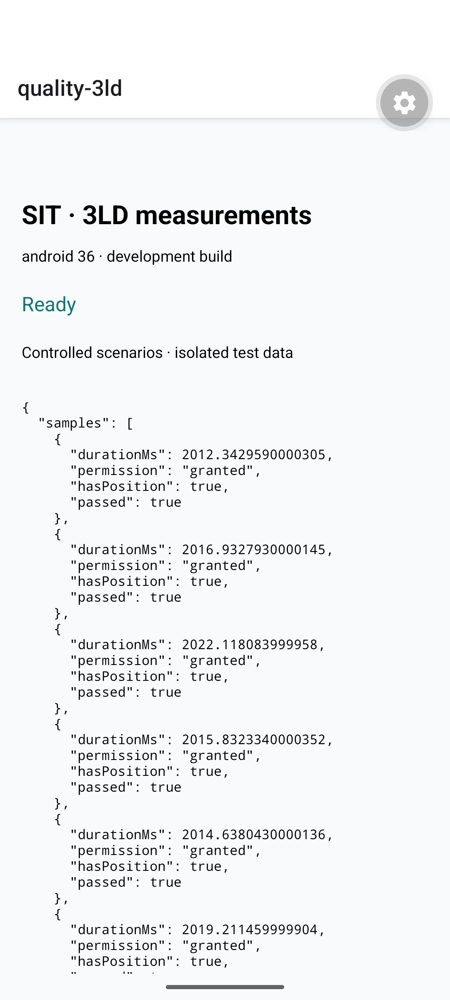

**1 pav.** Vietos sinchronizavimas su 2000 ms vėlinimu Android emuliatoriuje.

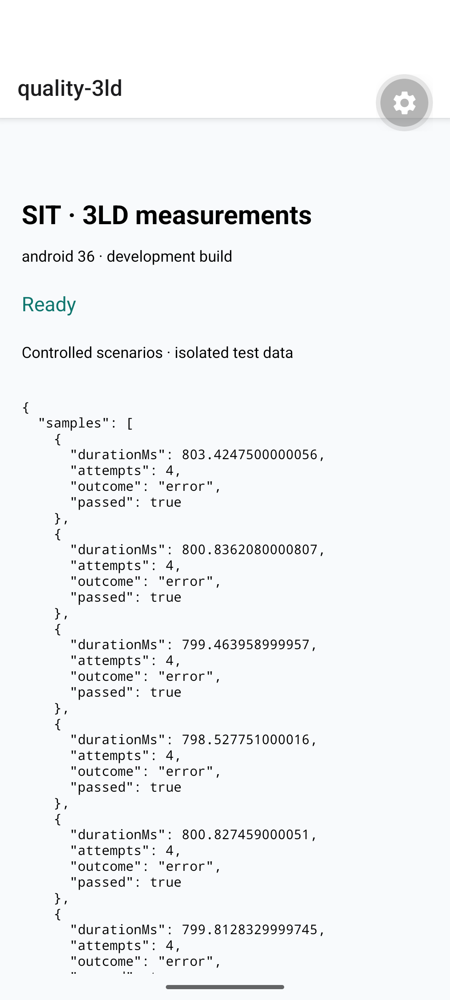

**2 pav.** Produkcinių native komandų kartojimo rezultatai po nuolatinės klaidos.

## 2 Ugnius Mikalauskis

**Resource utilization ir Capacity.** Reikalavimai: [SIT-40](https://placeholdder.atlassian.net/browse/SIT-40) ir [SIT-97](https://placeholdder.atlassian.net/browse/SIT-97).

| Metrika                               | Aplinkybė                                            | Rezultatas                | Žalia zona                        | Įvertinimas |
| ------------------------------------- | ---------------------------------------------------- | ------------------------- | --------------------------------- | ----------- |
| U1 Didžiausias stebėtas RAM prieaugis | Vieno markerio orų užkrovimas                        | 0,00 MiB                  | ≤ 20 MiB                          | 🟢 Atitinka |
| U1 Didžiausias stebėtas RAM prieaugis | 20 skirtingų markerių orų užkrovimas                 | 2,27 MiB                  | ≤ 50 MiB                          | 🟢 Atitinka |
| U2 API užklausos naudojant cache      | Cache amžius 29 min; 10 atidarymų                    | 0 API užkl.               | 0 API užkl.                       | 🟢 Atitinka |
| U2 API užklausos naudojant cache      | Cache amžius 31 min; 10 atidarymų                    | 1 API užkl.               | 1 API užkl.                       | 🟢 Atitinka |
| U3 Lygiagrečių užklausų aptarnavimas  | Lygiagrečių užklausų skaičius: 5; testinis serveris  | 50/50 per 5 s (100,0 %)   | ≥ 95 % per 5 s                    | 🟢 Atitinka |
| U3 Lygiagrečių užklausų aptarnavimas  | Lygiagrečių užklausų skaičius: 20; testinis serveris | 200/200 per 5 s (100,0 %) | ≥ 95 % per 5 s                    | 🟢 Atitinka |
| U4 Išlaikytų cache įrašų skaičius     | Cache įrašų skaičius: 1                              | 1 iš 1, 10/10 band.       | Išlaikyti visi galiojantys įrašai | 🟢 Atitinka |
| U4 Išlaikytų cache įrašų skaičius     | Cache įrašų skaičius: 200                            | 200 iš 200, 10/10 band.   | Išlaikyti visi galiojantys įrašai | 🟢 Atitinka |

Orų gavimui vykdėme esamą useMarkerWeather ir Open-Meteo atsakymo apdorojimą. Apkrovos duomenis tiekė vietinis serveris su 100 ms vėlinimu; tai nėra viešo Open-Meteo serverio pralaidumo matavimas. Tikra integracija papildomai patikrinta viena užklausa. Cache galioja 30 minučių; 29 ir 31 min amžių sukūrėme nustatydami įrašo saugojimo laiką. RAM matavome kaip didžiausią Android proceso PSS prieaugį po užkrovimo, lyginant su pradine verte. 0 MiB reiškia, kad stebėta atmintis neviršijo pradinės vertės; tai nereiškia, kad atmintis apskritai nebuvo naudojama. Talpos bandymas patvirtina tik išbandytus kiekius, ne maksimalią ribą.

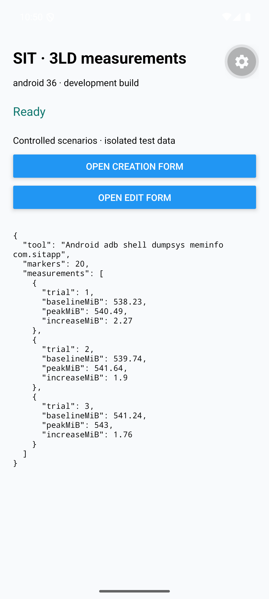

**3 pav.** Android proceso PSS matavimų suvestinė; duomenys gauti su adb dumpsys.

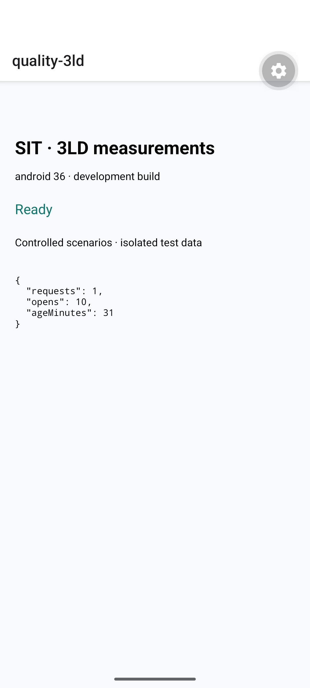

**4 pav.** Pasibaigus cache galiojimui per 10 atidarymų siunčiama viena užklausa.

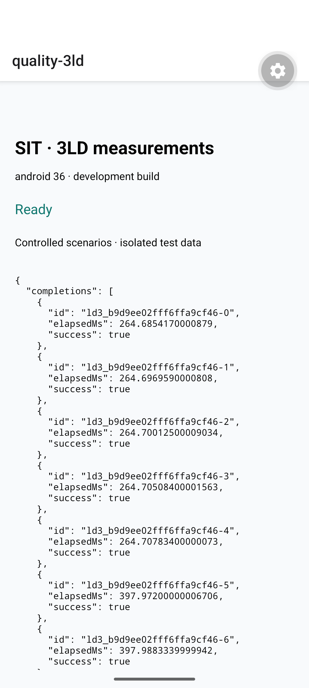

**5 pav.** 20 lygiagrečių orų užklausų bandymas programėlėje.

## 3 Matas Siaurodinas

**Authenticity ir User error protection.** Reikalavimai: [SIT-27](https://placeholdder.atlassian.net/browse/SIT-27) ir [SIT-93](https://placeholdder.atlassian.net/browse/SIT-93).

| Metrika                                    | Aplinkybė                          | Rezultatas      | Žalia zona | Įvertinimas   |
| ------------------------------------------ | ---------------------------------- | --------------- | ---------- | ------------- |
| M1 Sesijos patikros tikslumas              | Galiojanti testinė sesija          | 10/10 (100,0 %) | 100 %      | 🟢 Atitinka   |
| M1 Sesijos patikros tikslumas              | Netinkamas JWT                     | 10/10 (100,0 %) | 100 %      | 🟢 Atitinka   |
| M2 Įvertinimo autoriaus tapatybės kontrolė | A pateikia savo įvertinimą         | 10/10 (100,0 %) | 100 %      | 🟢 Atitinka   |
| M2 Įvertinimo autoriaus tapatybės kontrolė | A pateikia įvertinimą B vardu      | 0/10 (0,0 %)    | 100 %      | 🔴 Neatitinka |
| M3 Netinkamo reitingo atmetimas            | Reitingo balas 0                   | 10/10 (100,0 %) | 100 %      | 🟢 Atitinka   |
| M3 Netinkamo reitingo atmetimas            | Reitingo balas 6                   | 10/10 (100,0 %) | 100 %      | 🟢 Atitinka   |
| M4 Pakartotinio pateikimo prevencija       | Vienas pateikimo paspaudimas       | 10/10 (100,0 %) | 100 %      | 🟢 Atitinka   |
| M4 Pakartotinio pateikimo prevencija       | Penki greiti pateikimo paspaudimai | 10/10 (100,0 %) | 100 %      | 🟢 Atitinka   |

Saugumą tikrinome tikrais Appwrite atsakymais: su testinio naudotojo JWT, be administratoriaus rakto. Galiojanti sesija priimta, netinkama atmesta. Tačiau A galėjo išsaugoti įvertinimą su B naudotojo ID: sesija patikrinama, bet įrašo autoriaus laukas su ja nesusiejamas. Reitingų ribos tikrintos produkcine funkcija, o paspaudimai – originaliu Rating UI ir hook. Vien įrašų skaičiaus nepakanka: taip pat skaičiuotos tikros rašymo užklausos. Bandymuose pridėtas 700 ms užklausos vėlinimas, kad būtų galima spausti pateikimą jam dar vykstant.

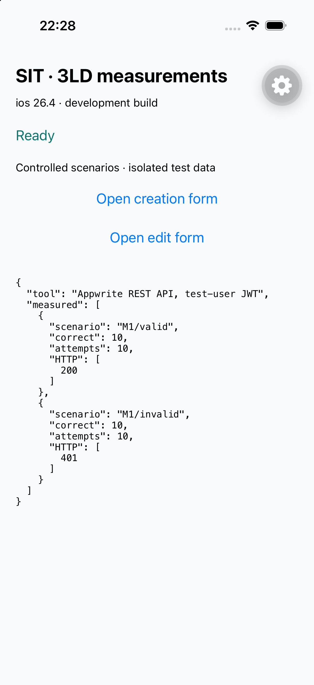

**6 pav.** Appwrite galiojančios ir netinkamos sesijos rezultatų peržiūra.

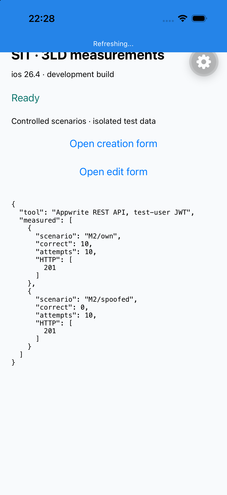

**7 pav.** Appwrite autoriaus tapatybės bandymų rezultatų peržiūra.

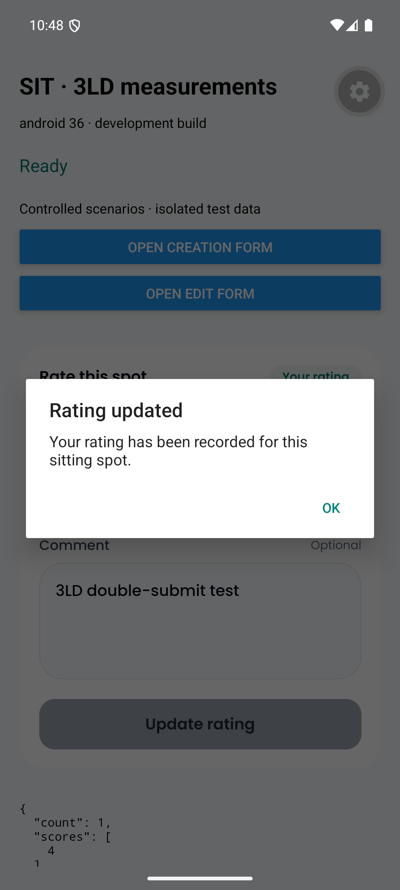

**8 pav.** Penkių pateikimo paspaudimų bandymas Android emuliatoriuje.

## 4 Marius Seniucas

**Integrity ir User assistance.** Reikalavimai: [SIT-104](https://placeholdder.atlassian.net/browse/SIT-104) ir [SIT-110](https://placeholdder.atlassian.net/browse/SIT-110).

| Metrika                                         | Aplinkybė                                              | Rezultatas      | Žalia zona                          | Įvertinimas   |
| ----------------------------------------------- | ------------------------------------------------------ | --------------- | ----------------------------------- | ------------- |
| R1 Markerio būsenų kontrolė                     | Naują markerį sukuria produkcinė createMarker funkcija | 10/10 (100,0 %) | 100 %                               | 🟢 Atitinka   |
| R1 Markerio būsenų kontrolė                     | Autorius tiesiogiai per API keičia būseną į approved   | 0/10 (0,0 %)    | 100 %                               | 🔴 Neatitinka |
| R2 Įkeliamo failo turinio kontrolė              | Tikras PNG paveikslėlis                                | 10/10 (100,0 %) | 100 %                               | 🟢 Atitinka   |
| R2 Įkeliamo failo turinio kontrolė              | Tekstas su JPG pavadinimu ir MIME tipu                 | 0/10 (0,0 %)    | 100 %                               | 🔴 Neatitinka |
| R3 Aiškiai įvardyti formų valdikliai            | Markerio kūrimo forma                                  | 14/16 (87,5 %)  | 100 % įvardytų pasirinktų valdiklių | 🔴 Neatitinka |
| R3 Aiškiai įvardyti formų valdikliai            | Markerio redagavimo forma                              | 12/13 (92,3 %)  | 100 % įvardytų pasirinktų valdiklių | 🔴 Neatitinka |
| R4 Formų veiksmų pasiekiamumas pagal pavadinimą | Kūrimo formos 3 veiksmai pagal pavadinimą              | 30/30 (100,0 %) | 100 %                               | 🟢 Atitinka   |
| R4 Formų veiksmų pasiekiamumas pagal pavadinimą | Redagavimo formos 3 veiksmai pagal pavadinimą          | 30/30 (100,0 %) | 100 %                               | 🟢 Atitinka   |

Įprastą markerį kūrė esama createMarker funkcija, o savavališką patvirtinimą bandė jo autorius tiesiogine API užklausa. Autoriui pavyko pakeisti būseną į approved. Saugykla priėmė ir tikrą PNG, ir paprastą tekstą, pateiktą kaip JPG. Failo plėtinys bei MIME tipas vieni turinio nepatvirtina. Prieinamumui išsaugojome tikrą sistemos elementų medį: vertinome 16 kūrimo ir 13 redagavimo formos valdiklių. Įvestas tekstas bei placeholder nelaikyti aiškia lauko žyme. Veiksmų bandymuose ieškota pagal pavadinimą, nenaudojant ekrano koordinačių. Paspaudimas patvirtintas formos callback; nuotraukų parinkiklio ar VoiceOver patirtis šiuo bandymu nevertinta.


**9 pav.** Appwrite būsenos kontrolės rezultatų peržiūra.

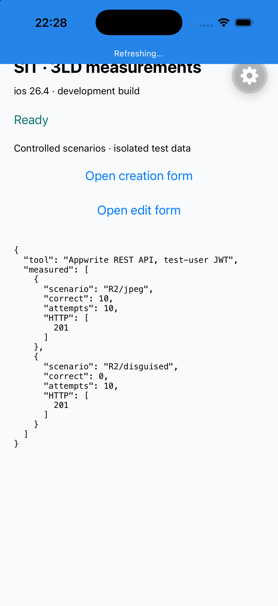

**10 pav.** Appwrite tikro PNG ir netinkamo failo bandymų rezultatų peržiūra.

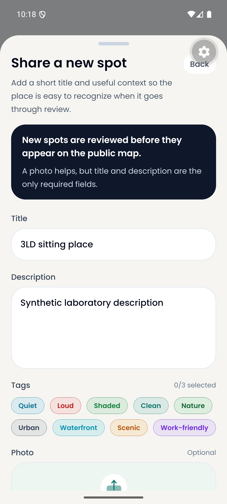

**11 pav.** Originali markerio kūrimo forma prieinamumo patikroje.

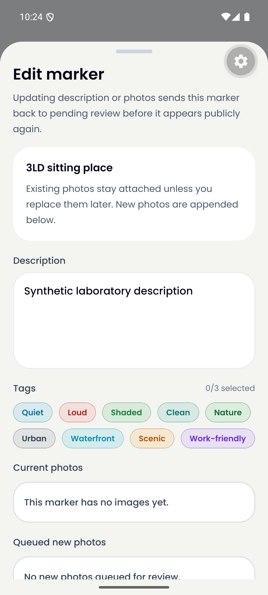

**12 pav.** Originali markerio redagavimo forma prieinamumo patikroje.

## 5 Papildomas iOS patikrinimas

iOS Simulator pakartojome OS vietos leidimo suteikimą ir atšaukimą, valdomas vietos klaidas, reitingų 0 ir 6 atmetimą bei vieno ir penkių markerių orų gavimą. Abi formos atvertos ir užfiksuotos. Tai papildoma integracijos patikra; ji nepakeičia Android metrikų ir neįrodo tikro GPS ar ekrano skaitytuvo veikimo fiziniame telefone.

## 6 Išvados ir rekomendacijos

Bandymuose klaidų apdorojimas ir cache veikė pagal nustatytus scenarijus. Didžiausią riziką parodė Appwrite įrašų autoriaus ir būsenos kontrolė bei failų turinio patikra. Produkto šiame tyrime netaisėme.

1. **Įvertinimo autorių nustatyti serveryje pagal sesiją.** Kito autoriaus ID priimtas 10/10 bandymų. Vien kliento perduodamu user_id pasitikėti negalima: tiesioginė API užklausa apeina formą. Tai atitinka [OWASP rekomendaciją teises tikrinti kiekvienoje užklausoje](https://cheatsheetseries.owasp.org/cheatsheets/Authorization_Cheat_Sheet.html#validate-the-permissions-on-every-request). Tikslas po pataisos – 0/10 priimtų apsimetimo bandymų.
2. **Markerio būseną keisti per serverio moderavimo operaciją.** Autoriui palikti tik leistinų laukų redagavimą; approved turi būti pasiekiama tik moderatoriui. Dabartinė dokumento update teisė leido patvirtinti savo markerį 10/10 bandymų.
3. **Tikrinti tikrą įkeliamo paveikslėlio turinį.** Tekstas priimtas 10/10 bandymų. Tikrinti formato parašą ir galimybę dekoduoti paveikslėlį, o ne vien jo pavadinimą ar deklaruojamą MIME tipą. Tai pagrindžia [OWASP failų įkėlimo gairės](https://cheatsheetseries.owasp.org/cheatsheets/File_Upload_Cheat_Sheet.html#file-signature-validation).
4. **Įvesties laukams pridėti aiškias accessibilityLabel žymes.** Kūrimo formoje patikrinti Title ir Description, redagavimo – Description. Matomas lauko tekstas neturėtų pakeisti jo paskirtį nusakančio pavadinimo. Po pakeitimo pakartoti to paties UI medžio auditą.
5. **Apriboti vietos laukimą ir rodyti aiškią laukimo būseną.** Pridėjus 2000 ms vėlinimą viršyta 1500 ms riba. Galima pirmiausia pateikti ankstesnę žinomą vietą su jos amžiumi, o dabartinę atnaujinti vėliau; nesėkmės atveju leisti pakartoti veiksmą.
6. **Cache apriboti pagal įrašų skaičių ir pašalinti pasenusius įrašus.** 200 įrašų bandymas praėjo, tačiau dabartinis Map neturi bendro dydžio ribos. Tai nėra įrodymas, kad neribotas markerių skaičius nekels atminties problemų.

### Pakartojimas per gynimą

Matavimo skriptai ir [trumpa paleidimo instrukcija](PALEIDIMAS.md) pateikti kartu. Pavyzdžiui, parametrą galima pakeisti ir iškart pakartoti vietos scenarijų:

```bash
npm run quality:3ld:measure -- --kind location --options '{"metric":"demo","scenario":"delayed","delayMs":3000,"repeats":5}'
```

Pirminiai duomenys: [rezultatų suvestinė](results.json), [CSV lentelė](results.csv). [Visi ekrano vaizdai](IRODYMAI.md). Pilni bandymų įrašai, UI medžiai ir papildomi ekrano vaizdai lieka projekto reports/3ld kataloge.

### Šaltiniai

- [ISO/IEC 25010:2023 produkto kokybės modelis](https://www.iso.org/standard/78176.html).
- [OWASP autorizacijos gairės](https://cheatsheetseries.owasp.org/cheatsheets/Authorization_Cheat_Sheet.html).
- [OWASP failų įkėlimo gairės](https://cheatsheetseries.owasp.org/cheatsheets/File_Upload_Cheat_Sheet.html).
- [Maestro dokumentacija](https://docs.maestro.dev/), [Android atminties matavimas](https://developer.android.com/tools/dumpsys#meminfo), [Open-Meteo naudojimo ribos](https://open-meteo.com/en/terms).
